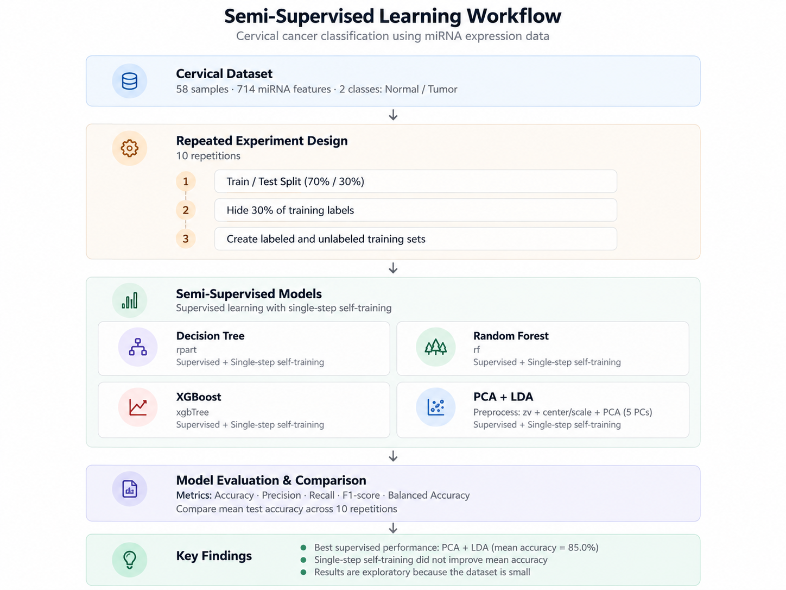
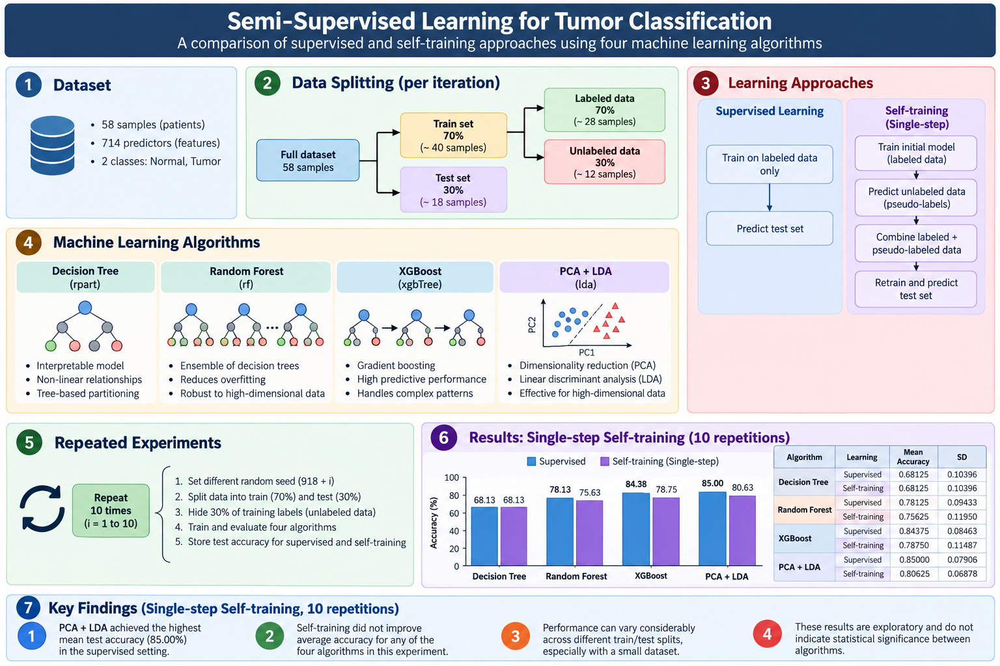
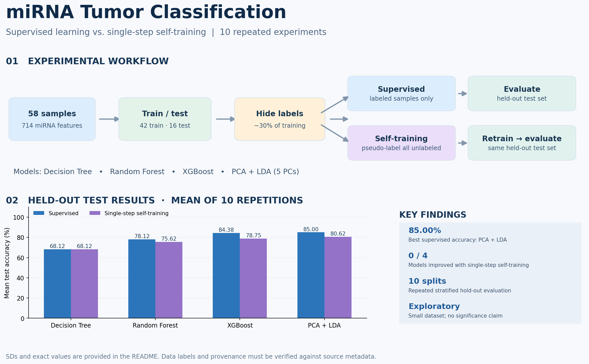

# Semi-Supervised Learning for Cervical Cancer Classification Using miRNA Expression Data

A beginner-friendly R project comparing **supervised learning** with **single-step self-training** for binary classification of cervical cancer samples using miRNA expression features.

> **Project status:** Supervised and single-step self-training experiments (10 repetitions) are complete. Confidence-based iterative self-training is planned but has not yet been evaluated.

## Visual Summary



## Project Overview



*Figure 1. Overview of the dataset, supervised learning, single-step self-training, and the classification workflow. The illustrated sample counts are schematic; the implemented stratified split uses 42 training and 16 test samples.*

## Research Question

**Does adding pseudo-labeled training samples improve classification performance when only a small number of samples have known labels?**

We compare four classification pipelines using identical train/test splits:

- **Decision Tree** (`caret` / `rpart`)
- **Random Forest** (`caret` / `rf`)
- **XGBoost** (`caret` / `xgbTree`)
- **PCA + Linear Discriminant Analysis** (`caret` / `lda`)

## Dataset

The analysis uses a cervical miRNA expression dataset.

| Property | Value |
|---|---|
| Samples | 58 |
| miRNA expression features | 714 |
| Target classes | Normal and Tumor |
| Machine-learning task | Binary classification |

The R script imports a local tabular dataset, transposes it into a **samples x features** matrix, and creates a `patient_status` factor.

The first 29 samples are assigned `Normal` and the next 29 `Tumor` in the current workflow. This ordering should be verified against the original dataset metadata before biological interpretation or public reuse.

> The dataset contains substantially more features than samples. Consequently, model performance may be sensitive to the training/test partition.

## Experimental Design

The experiment is repeated **10 times**.

For each repetition:

1. Create a **stratified 70% training / 30% test split** using `caret::createDataPartition`.
2. Randomly hide **30% of the training labels** to simulate unlabeled samples.
3. Train a **supervised baseline model** using only genuinely labeled training samples.
4. Predict pseudo-labels for all unlabeled samples.
5. Combine labeled and pseudo-labeled samples.
6. Retrain the classifier once using the combined dataset.
7. Evaluate supervised and self-training models on the same held-out test set.
8. Record test accuracy for each model.

The same train/test partition and labeled/unlabeled split are used across algorithms within each repetition.

Random seeds:

- Data splitting: `918 + i`
- Model training: `123`

The `caret` package uses its default bootstrap resampling procedure for model training and hyperparameter tuning.

## Learning Strategies

### 1. Supervised Learning

The classifier is trained exclusively on the available labeled samples.

### 2. Single-Step Self-Training

The classifier is initially trained using labeled samples. It then predicts labels for all unlabeled training samples.

These pseudo-labeled samples are combined with the original labeled data, and a new classifier is trained once.

**No confidence threshold is applied in the current single-step experiment.**

### Special Handling for LDA

Since the number of predictors (714) exceeds the number of labeled training samples, traditional LDA cannot be applied reliably without dimensionality reduction.

The following preprocessing pipeline is used:

```r
preProcess = c("zv", "center", "scale", "pca")
preProcOptions = list(pcaComp = 5)
```

This pipeline:

- Removes zero-variance features.
- Centers and scales the remaining predictors.
- Performs Principal Component Analysis.
- Retains five principal components for LDA classification.

Preprocessing is learned from training data and applied to the test set without fitting PCA on test samples.

The number of principal components was fixed for this exploratory experiment.

## Results: 10 Repeated Experiments

The following table presents the **mean held-out test accuracy** and **standard deviation** across 10 repetitions.

| Algorithm | Supervised Accuracy | Self-Training Accuracy | Supervised SD | Self-Training SD |
|---|---:|---:|---:|---:|
| Decision Tree | 68.13% | 68.13% | 0.1040 | 0.1040 |
| Random Forest | 78.13% | 75.63% | 0.0943 | 0.1195 |
| XGBoost | 84.38% | 78.75% | 0.0846 | 0.1149 |
| **PCA + LDA** | **85.00%** | **80.63%** | **0.0791** | **0.0688** |

### Model Performance Visualization



*Figure 2. Model performance comparison across 10 repeated experiments.*

### Interpretation

**1. Best supervised model**

PCA + LDA achieved the highest mean test accuracy (**85.00%**), closely followed by XGBoost (**84.38%**).

**2. Effect of single-step self-training**

Single-step self-training did not improve mean accuracy for any of the four algorithms.

- Decision Tree: No change.
- Random Forest: Lower mean accuracy.
- XGBoost: Lower mean accuracy.
- PCA + LDA: Lower mean accuracy.

**3. Possible explanation**

Including all pseudo-labeled samples without considering prediction confidence may introduce incorrectly labeled observations into the training data.

However, this hypothesis has not yet been directly tested.

**4. Statistical considerations**

The findings are exploratory due to the limited sample size. Repeated train/test splits may share observations, and 10 repetitions do not establish statistical significance or external generalizability.


> **Compatibility note:** An older XGBoost 1.7.x release was used because of compatibility issues with newer versions when integrated with `caret`.

## Running the Project

1. Install the required R packages.
2. Obtain the cervical miRNA dataset from its original source.
3. Update the `file_path` variable in the R script.
4. Run the data preprocessing steps.
5. Execute the supervised and single-step self-training experiments.
6. Run the 10-repetition evaluation.
7. Inspect the `comparison_10` results table.

For full reproducibility, dataset provenance, class-label ordering, package versions, and file paths should be verified and documented.

## Planned Work

The next stage will investigate **confidence-based iterative self-training**.

Planned steps include:

- Train an initial classifier using labeled observations.
- Estimate prediction probabilities for unlabeled observations.
- Select pseudo-labels exceeding a predefined confidence threshold.
- Add selected samples to the labeled training set.
- Retrain the classifier iteratively.
- Stop when no additional samples satisfy the selection criteria or a stopping limit is reached.
- Repeat the experiment across the same 10 data splits.
- Compare iterative self-training with supervised learning and single-step self-training.

Additional evaluation metrics such as sensitivity, specificity, F1-score, and ROC-AUC may be included in future experiments.

## Limitations

- The dataset contains only 58 samples.
- The number of miRNA features is high relative to the sample size.
- Model performance may vary considerably across data partitions.
- The current self-training approach does not filter uncertain pseudo-labels.
- External validation has not been conducted.
- The reported accuracies should not be interpreted as clinically validated diagnostic performance.

This project is intended for **educational and exploratory machine-learning research**, not clinical diagnosis.
